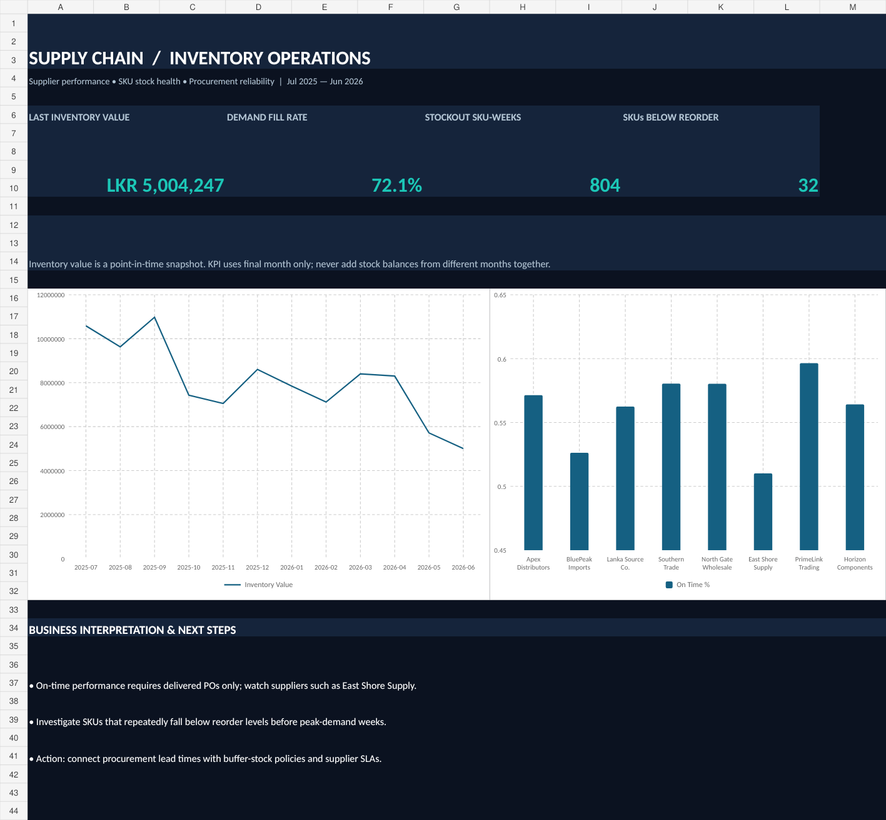

# Supply Chain & Inventory Operations | Power BI + Excel + SQL

> **Portfolio simulation: all data is synthetic.** Prices are illustrative LKR.

**Business question:** Which suppliers deliver reliably, and which products are at risk of stockouts?

**Data:** 8 suppliers, 45 SKUs, 950 purchase orders, 2,340 SKU-week inventory snapshots, Jul 2025–Jun 2026 dashboards.

**KPIs:** on-time delivery %, received-order unit fill %, mean lead days, end-of-week inventory value, SKU stockout count, demand fill %.

**Starter dashboard:** `Supply_Chain_Excel_Dashboard.xlsx`. **Power BI build:** `powerbi/Build_Guide.md` + `powerbi/Measures.dax`. **SQL queries:** `sql/02_business_queries.sql`. **Runnable:** `analysis.db` (SQLite).

### Metric interpretation
- On-time = received on or before promised date, over **received** POs only. Open POs excluded.
- Vendor fill % = quantities received divided by quantities ordered on received POs.
- Snapshot stock values can be aggregated **across SKUs for a single date**, but must never be summed across snapshot dates.
- Stockout SKU-week = a SKU with **ending** balance 0 for a week. Demand fulfilled is an illustrative weekly estimate, not a transaction-level fulfillment ledger.

### Simulated finding
- On-time delivery across received purchase orders: 55.1%.
- Latest displayed inventory value: LKR 5,004,247.
- This suggests screening suppliers using on-time %, fill %, and lead time together rather than optimizing unit cost alone.

### How to use
1. Open the Excel example. Use the two Power BI files to build the actual interactive `.pbix`.
2. Open `analysis.db` in DB Browser for SQLite, or run queries through the `sqlite3` CLI.
3. Save dashboard screenshots in your repo after implementing the Power BI report.
